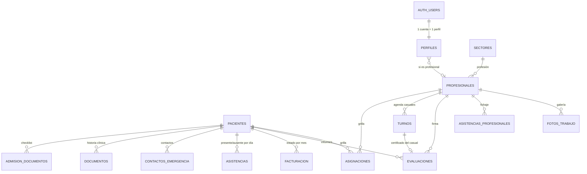

# Base de datos — cómo está organizada

**Motor:** PostgreSQL, alojado en **Supabase**. La app no tiene servidor propio: el
navegador habla con la base a través de la API de Supabase, y lo que cada usuario puede
leer o escribir lo decide la **propia base** (Row Level Security por rol).

- **16 tablas** propias en el esquema `public`, en 5 grupos.
- Las **cuentas de login** viven aparte, en `auth.users` (las maneja Supabase Auth).
- Los **archivos** (PDF, fotos) van al **Storage**, no a las tablas: la tabla guarda solo
  la ruta del archivo.
- Todas las claves primarias son **UUID**.

---

## Mapa general

`GASTOS` y `CONVENIOS` no se relacionan con otras tablas.

---

## 1. Usuarios y permisos

| Tabla | Qué guarda | Claves y reglas |
|---|---|---|
| `auth.users` | Cuentas de login (email, contraseña cifrada). La maneja Supabase. | — |
| **perfiles** | Lo que la app necesita saber de cada usuario: `nombre`, `email`, **`rol`**, `secciones` (las que tiene habilitadas), `avatar`, `profesional_id`. | `id` = el mismo de `auth.users` (si se borra la cuenta, se borra el perfil). `rol` solo puede ser `director`, `secretaria`, `profesional` o `cm`. `profesional_id` enlaza el usuario con su ficha de profesional. |

**Por qué dos tablas:** `auth.users` es de Supabase y no se puede modificar; `perfiles` es
nuestra y agrega el rol y los permisos.

---

## 2. Pacientes e historia clínica

| Tabla | Qué guarda | Claves y reglas |
|---|---|---|
| **pacientes** | Legajo: nombre, **DNI**, nacimiento, domicilio, escuela, referente, diagnóstico, CUD (sí/no), obra social y afiliado, fecha de ingreso. | **DNI único.** `estado` = activo / inactivo (**baja lógica**). `estado_admision` = en_admision / admitido / rechazado. |
| **admision_documentos** | Checklist de admisión: qué requisito presentó cada paciente. | Único por (paciente, requisito). |
| **documentos** | Historia clínica: tipo (CUD, DNI, estudios, informe…), número, emisión, vencimiento, notas y la **ruta del archivo** en el Storage. | `tipo` restringido a una lista fija. Los vencimientos alimentan las alertas de Inicio. |
| **contactos_emergencia** | Nombre, vínculo y teléfono. | → paciente. |

---

## 3. Equipo y organización de la atención

| Tabla | Qué guarda | Claves y reglas |
|---|---|---|
| **profesionales** | Datos, matrícula, especialidad, **`sector`**, `dias_trabajo` y `turnos_trabajo` (`{manana}`, `{tarde}` o ambos). | `sector` → `sectores.clave`. Baja lógica con `estado`. |
| **sectores** | Las profesiones del centro (Psicología, Fonoaudiología…): son las columnas y colores de la grilla. | `clave` única. Se agregan desde la app, sin tocar código. |
| **asignaciones** | **La grilla de atención.** Cada fila es una celda: profesional × franja de 30 min (`hora`) → paciente. | **Una sola celda vigente por (profesional, hora)**: índice único parcial. Tiene **vigencia** (`vigente_desde` / `vigente_hasta`): al cambiar de paciente no se pisa la fila, se cierra y se crea otra. |
| **turnos** | **Agenda de casuales** (sin legajo): nombre, teléfono y DNI anotados en el turno, profesional, fecha, hora y estado (programado / atendido / ausente / cancelado). | Todo turno dice de quién es. No tiene FK a pacientes a propósito: el casual no tiene legajo. |

---

## 4. Seguimiento diario y documentos profesionales

| Tabla | Qué guarda | Claves y reglas |
|---|---|---|
| **asistencias** | Asistencia del paciente por día: presente / ausente / con aviso / enfermo. | **Única por (paciente, fecha)**: se guarda con *upsert*. |
| **asistencias_profesionales** | Fichaje: entrada, salida y estado (presente / ausente / licencia). | **Única por (profesional, fecha).** |
| **evaluaciones** | Informes (`mensual`, `anual`, `evolucion`, `admision`) y la **evaluación / certificado** (`certificado`). El texto va en `contenido` como **JSON** (tipo, título, cuerpo). | Única por (paciente, profesional, fecha, **tipo**): un informe no pisa a otro del mismo día. El certificado de un casual no tiene paciente: va atado a su `turno_id` (uno por turno). |
| **fotos_trabajo** | Fotos del trabajo del mes (galería): profesional, `periodo` ('2026-10'), ruta del archivo. | Se borran solas a los 3 meses. |

---

## 5. Gestión de la sociedad

| Tabla | Qué guarda | Claves y reglas |
|---|---|---|
| **facturacion** | Estado de facturación de cada paciente por mes: no facturado / facturado / cobrado. | Única por (paciente, periodo). Es control, no emite facturas. |
| **gastos** | Fecha, concepto, monto, **socio que pagó**, categoría. | Solo director y secretaría (ni lectura para el resto). |
| **convenios** | Obras sociales. | Sección oculta por ahora. |

---

## Storage (archivos)

| Bucket | Qué guarda | Acceso |
|---|---|---|
| `documentos` | Archivos de la historia clínica, PDF de informes y fotos de la galería (carpeta `galeria/`). | **Privado.** Se ven con enlaces firmados que vencen. |
| `avatares` | Foto de perfil de cada usuario. | Cada usuario solo puede escribir en su propia carpeta. |

---

## Seguridad dentro de la base (RLS)

Cada tabla tiene **políticas** que Postgres evalúa en cada consulta, según quién está
logueado:

- Funciones de apoyo: `rol_actual()` (lee el rol del usuario en `perfiles`),
  `puede_operar()` (director o secretaría) y `es_director()`.
- **Sin sesión no se ve nada.**
- Todos los usuarios logueados pueden **leer** lo operativo; **escribir** solo director y
  secretaría.
- Excepción: el **profesional** sí puede crear informes, certificados y adjuntar sus PDF.
- **Gastos, facturación y convenios**: ni siquiera se leen sin ser director o secretaría.
- Cambiar el avatar va por una función (`actualizar_mi_avatar`) que solo toca esa columna,
  para que nadie pueda cambiarse el rol a sí mismo.

---

## Decisiones de diseño (para defender)

1. **Baja lógica.** Pacientes y profesionales no se borran: se marcan inactivos. Borrarlos
   destruiría la historia clínica, la asistencia y la autoría de los informes.
2. **Vigencia en la grilla.** Una celda no se pisa: se cierra con fecha y se crea otra. Así
   se sabe con quién se atendía cada paciente y desde cuándo.
3. **Unicidad en la base, no solo en la pantalla.** Un paciente por DNI, una asistencia por
   día, una celda vigente por profesional y hora. Aunque dos personas guarden al mismo
   tiempo, la base rechaza el duplicado.
4. **JSON en `evaluaciones.contenido`.** El informe tiene título y secciones que fueron
   cambiando; guardarlo como JSON evitó migrar la base cada vez, y los informes viejos se
   siguen leyendo.
5. **Períodos como texto** (`'2026-10'`) en facturación y galería: se ordenan y comparan
   sin cálculos de fechas.
6. **Archivos fuera de las tablas.** La tabla guarda la ruta; el archivo va al Storage
   privado. La base queda liviana y los archivos protegidos.
7. **Casuales sin FK a pacientes.** Un casual no tiene legajo; sus datos van en el turno.
   Si después se admite como paciente, pasa por Admisión como cualquiera.

---

## Detalles que conviene conocer

- Las tablas originales (`pacientes`, `profesionales`, `documentos`, `asistencias`,
  `contactos_emergencia`, `asignaciones`) se crearon desde el panel de Supabase; los
  scripts de `supabase/sql/` las **extienden** y crean el resto.
- Hay columnas **heredadas que ya no se usan** y se dejaron para no perder datos:
  `pacientes.turno`, `profesionales.horario_entrada` / `horario_salida` (reemplazadas por
  `turnos_trabajo`), `asignaciones.profesional_nombre` y `duracion_min` (de la grilla
  vieja), y `turnos.paciente_id` (de cuando la agenda era para pacientes con legajo).
